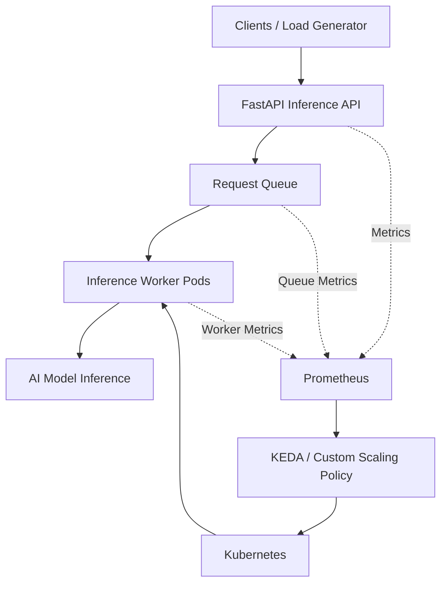

# Serverless GPU Inference Auto-Scaling System

> **Project Status:** Planning and initial documentation  
> **Primary Goal:** Reduce idle GPU resource time while maintaining acceptable inference latency and SLA compliance through queue-based autoscaling.

## 1. Overview

AI inference workloads often fluctuate over time. Keeping too many GPU workers running during low traffic wastes resources, while insufficient capacity during traffic spikes can cause long queues, increased response times, and request timeouts.

The **Serverless GPU Inference Auto-Scaling System** aims to build and evaluate a Kubernetes-based infrastructure that automatically scales AI inference workers according to workload demand.

The system will use queue-based metrics, monitoring, and a custom scaling policy to determine when inference pods should scale up or down. Special attention will be given to GPU pod startup delays, which can affect response latency during sudden increases in demand.

Development will initially use mock inference so that queue handling, monitoring, and autoscaling can be tested without GPU hardware. Real GPU experiments will be performed when suitable infrastructure is available.

## 2. Research Question

**How much idle GPU time can queue-based scaling remove while keeping SLA violations low, given slow GPU pod start-up?**

## 3. Objectives

- Develop an inference API using Python and FastAPI.
- Deploy inference services using Docker and Kubernetes.
- Monitor queue depth, request latency, throughput, errors, and replica count.
- Configure queue-based autoscaling using KEDA.
- Implement a custom scaling policy that accounts for workload changes and pod startup delays.
- Measure GPU pod cold-start and readiness time.
- Investigate cold-start mitigation techniques, including warm capacity and model/image caching.
- Compare fixed-capacity, CPU-based HPA, KEDA queue-based scaling, and the custom policy.
- Evaluate resource efficiency, latency, SLA violations, and cost.
- Produce reproducible experiments, visualizations, and a technical report.

## 4. Proposed System Architecture



### Architecture Components

- **FastAPI:** Receives inference requests and exposes API endpoints.
- **Request Queue:** Holds pending requests and provides workload metrics. Redis or RabbitMQ will be evaluated as possible implementations.
- **Inference Workers:** Process requests using a mock inference function initially and a real AI model during GPU experiments.
- **Prometheus:** Collects workload and service metrics.
- **KEDA:** Enables event-driven scaling based on configured queue or workload metrics.
- **Custom Scaling Policy:** Determines desired capacity using workload signals and, where appropriate, startup-aware rules.
- **Kubernetes:** Schedules and manages inference pods.
- **Load Generator:** Produces repeatable workloads for performance evaluation.

This architecture is proposed and may be refined during implementation.

## 5. Technology Stack

| Technology | Purpose |
|---|---|
| Python | Application logic, custom controller, and analysis |
| FastAPI | Inference API |
| Docker | Containerization |
| Kubernetes | Container orchestration |
| KEDA | Event-driven autoscaling |
| Prometheus | Metrics collection |
| Redis or RabbitMQ | Request queue |
| Locust or k6 | Load generation |
| NVIDIA GPU / CUDA | Real GPU inference experiments |
| Grafana (optional) | Metrics visualization |

The technologies listed above represent the planned stack; their implementation status will be updated as development progresses.

## 6. Evaluation Strategy

The system will be evaluated against the following approaches:

1. Fixed over-provisioned capacity.
2. Fixed under-provisioned capacity.
3. CPU-based Kubernetes Horizontal Pod Autoscaler (HPA).
4. KEDA queue-based autoscaling.
5. Custom queue-based scaling policy.

### Workload Patterns

- Steady traffic
- Sudden traffic bursts
- Gradual traffic increases and decreases
- Low-demand periods
- Repeated traffic bursts

### Evaluation Metrics

| Metric | Purpose |
|---|---|
| p95 latency | Measures latency experienced by the slower 5% of requests |
| p99 latency | Measures latency experienced by the slower 1% of requests |
| SLA violation rate | Measures the fraction of requests exceeding the defined latency target |
| Idle GPU-hours | Measures idle GPU capacity time using a documented accounting method |
| Cost per 1,000 requests | Compares infrastructure cost per completed request volume |
| Scale-up reaction time | Measures the time required for additional capacity to become ready |
| Cold-start time | Measures how long new inference pods take to become ready |
| Throughput | Measures the rate of successfully processed requests |
| Errors and timeouts | Measures reliability under different workloads |

SLA targets and scaling thresholds will be established in the experiment plan. No performance improvement will be claimed until supported by measured results.

## 7. Planned Repository Structure

```text
Serverless-GPU-Inference-Auto-Scaling-System/
│
├── README.md
├── SECURITY.md
├── CODE_STYLE.md
├── TESTING.md
├── ENVIRONMENT.md
├── CHANGELOG.md
│
├── docs/
│   ├── PRODUCT_REQUIREMENTS.md
│   ├── ARCHITECTURE.md
│   ├── USER_FLOW.md
│   ├── EXPERIMENT_PLAN.md
│   ├── TASKS.md
│   └── RESEARCH_NOTES.md
│
├── service/
├── controller/
├── k8s/
├── manifests/
├── loadtest/
├── tests/
├── configs/
├── dashboards/
├── results/
└── scripts/
```

This is the intended structure. Directories will be created as the corresponding implementation work begins.

## 8. Getting Started

The repository is currently at the initial documentation stage. Detailed installation and execution commands will be added once the service and deployment configurations are implemented.

### Planned Prerequisites

- Python
- Docker
- kubectl
- A local Kubernetes cluster, such as kind or Minikube
- KEDA and Prometheus
- Redis or RabbitMQ, depending on the final queue design
- NVIDIA GPU infrastructure for real-GPU experiments

A GPU is not required for the initial mock-inference implementation. However, actual GPU startup time, utilization, and cost must be evaluated using appropriate GPU infrastructure.

## 9. Project Roadmap

The project is planned over nine weeks.

| Week | Planned Milestone |
|---|---|
| 1 | Environment setup and mock inference API |
| 2 | Queue integration, load generator, and baseline measurements |
| 3 | Prometheus monitoring and KEDA queue-based scaling |
| 4 | Custom scaling policy and baseline comparison |
| 5 | Real GPU inference and cold-start measurements |
| 6 | Cold-start mitigation experiments |
| 7 | Controlled workload and scaling experiments |
| 8 | Latency, SLA, idle GPU time, and cost analysis |
| 9 | Final report, visualizations, documentation, and demonstration |

Refer to `docs/TASKS.md` for detailed implementation tasks once that file is created.

## 10. Documentation

- [Product Requirements](docs/PRODUCT_REQUIREMENTS.md)
- [Architecture](docs/ARCHITECTURE.md)
- [User Flow](docs/USER_FLOW.md)
- [Experiment Plan](docs/EXPERIMENT_PLAN.md)
- [Tasks and Roadmap](docs/TASKS.md)
- [Research Notes](docs/RESEARCH_NOTES.md)
- [Security](SECURITY.md)
- [Code Style](CODE_STYLE.md)
- [Testing](TESTING.md)
- [Environment Setup](ENVIRONMENT.md)
- [Changelog](CHANGELOG.md)

These links will become available as the documentation files are added.

## 12. Limitations and Assumptions

- GPU hardware or cloud GPU availability must be confirmed before real-GPU experiments.
- Mock inference can validate control flow but cannot establish real GPU startup time or GPU cost.
- Autoscaling performance depends on workload characteristics, model size, hardware, and pod startup delay.
- Cost comparisons must use a consistent accounting method and comparable experimental conditions.
- Proposed features and targets are not evidence of completed implementation or achieved results.

## License

A license has not yet been selected. Add an appropriate license before explicitly permitting reuse or redistribution.
