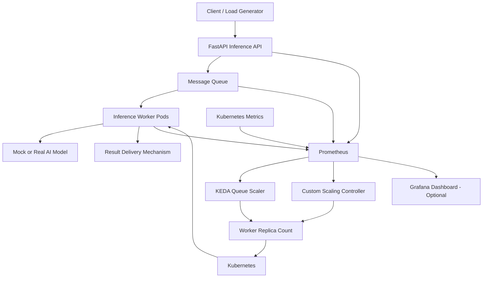
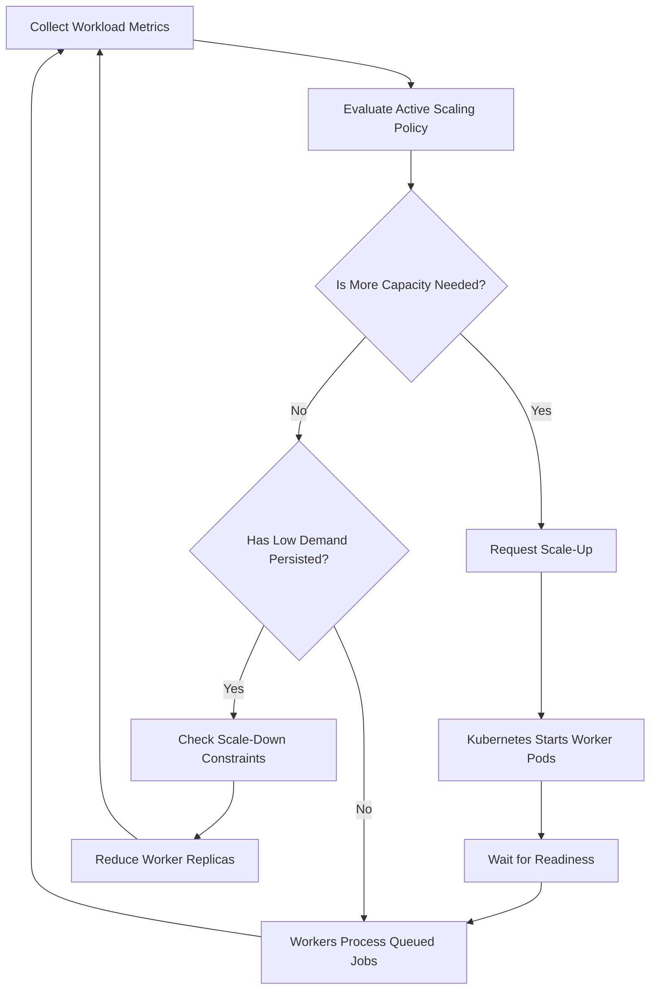

# System Architecture

## 1. Architecture Goals

- Separate request handling, queue management, inference execution, and scaling logic.
- Scale inference workers according to workload demand.
- Account for worker startup and readiness delays.
- Collect metrics to evaluate latency, resource utilization, and scaling behavior.
- Support reproducible comparisons between baseline and custom scaling strategies.
- Allow mock inference during development and real GPU inference when hardware is available.

## 2. High-Level Architecture

The diagram shows the logical design. KEDA and the custom controller are alternative scaling mechanisms for the experiments in which they are evaluated. They must not independently compete to control the same worker replica count.

## 3. Component Responsibilities

### 3.1 Client and Load Generator

**Responsibility:** Generate controlled inference workloads and measure client-visible performance.

Functions:

- Send inference requests at configurable rates.
- Simulate steady, bursty, and variable traffic.
- Configure test duration and concurrency.
- Record latency, failures, and timeouts.
- Repeat workload patterns across different scaling strategies.

**Proposed tools:** Locust or k6.

### 3.2 FastAPI Inference API

**Responsibility:** Accept and validate requests and submit inference jobs to the queue.

Functions:

- Expose HTTP endpoints for inference requests.
- Validate request payloads.
- Assign unique request IDs.
- Submit jobs to the message queue.
- Expose request status or results using the selected response mechanism.
- Publish API metrics for monitoring.

The API must use a consistent request-handling design across experiments. An asynchronous design can return a request ID immediately and provide separate status/result endpoints. A synchronous design must define how the API receives and returns the worker's result.

### 3.3 Message Queue

**Responsibility:** Buffer pending jobs and decouple request arrival from worker processing.

Candidate technologies:

- **Redis:** A lightweight option for a prototype.
- **RabbitMQ:** An alternative with explicit message acknowledgement and queue-management capabilities.

Functions:

- Store pending jobs.
- Expose queue depth or equivalent scaling metrics.
- Support multiple consumers.
- Define acknowledgement, retry, and failure behavior.
- Help prevent temporary traffic spikes from overwhelming the workers.

Only one queue technology should be selected for the initial implementation.

### 3.4 Inference Worker Pods

**Responsibility:** Retrieve queued jobs and execute inference.

Functions:

- Consume jobs from the queue.
- Execute mock or real model inference.
- Record processing duration and outcomes.
- Acknowledge successfully processed jobs.
- Handle failed jobs according to the configured retry policy.
- Expose health and readiness endpoints.

Kubernetes readiness probes should prevent workers from receiving traffic or jobs before they are ready to process them.

### 3.5 Model Execution Layer

The model execution layer supports two implementation stages.

**Mock inference**

- Simulates model-processing time.
- Allows controlled experiments without GPU hardware.
- Validates queueing, worker management, and autoscaling logic.

**Real inference**

- Loads a suitable machine-learning model.
- Executes inference on a compatible GPU when available.
- Measures model-loading time, throughput, GPU utilization, and startup delays.

Mock inference results must not be treated as evidence of real GPU utilization or GPU cost savings.

### 3.6 Kubernetes

**Responsibility:** Orchestrate containers and manage worker replicas.

Functions:

- Schedule worker pods.
- Maintain the desired replica count.
- Restart failed containers.
- Configure resource requests and limits.
- Run health and readiness probes.
- Support scaling within configured minimum and maximum replica counts.

Real GPU deployment additionally requires compatible GPU hardware, appropriate drivers, and the necessary Kubernetes GPU device integration.

### 3.7 KEDA Autoscaler

**Responsibility:** Provide queue-driven autoscaling for the baseline experiments.

Functions:

- Connect to the selected queue through a supported scaler.
- Evaluate queue-related scaling metrics.
- Adjust worker replica counts.
- Apply configured replica limits and scaling behavior.

KEDA will serve as the standard queue-based autoscaling baseline. Its performance will be measured against the project's requirements rather than assumed to be optimal.

### 3.8 Custom Scaling Controller

**Responsibility:** Implement the alternative scaling policy being investigated.

Potential inputs:

- Queue depth.
- Incoming request rate.
- Request completion rate.
- Observed latency.
- Current worker count.
- Estimated worker startup delay.

Potential behaviors:

- Scale up when predicted demand exceeds available processing capacity.
- Scale down after demand remains low for a defined period.
- Apply cooldowns or hysteresis to reduce rapid scaling fluctuations.
- Maintain configurable warm capacity when justified by experiments.

The exact algorithm, thresholds, and metric sources will be finalized during implementation and documented in the experiment plan.

The custom controller must have a clearly defined scaling interface and must not conflict with KEDA over the same replica count.

### 3.9 Prometheus

**Responsibility:** Collect time-series metrics for autoscaling and evaluation.

Metrics may include:

- Queue depth.
- Incoming request rate.
- Completed request rate.
- End-to-end latency.
- Worker processing duration.
- Worker replica count.
- Pod startup and readiness duration.
- Request errors and timeouts.
- GPU utilization and memory usage, when real GPU metrics are available.

Prometheus provides the monitoring data used to compare scaling strategies.

### 3.10 Grafana (Optional)

**Responsibility:** Visualize system behavior during experiments.

Potential dashboard panels:

- Queue depth over time.
- Request arrival and completion rates.
- p95 and p99 latency.
- Worker replica count.
- SLA violation rate.
- Pod startup duration.
- GPU utilization, where measurable.

Grafana is optional; collecting and recording evaluation metrics is mandatory.

## 4. Request Processing Flow

1. The load generator submits a request to FastAPI.
2. FastAPI validates the payload and assigns a request ID.
3. The API places the inference job in the message queue.
4. The queue retains the job until a worker can process it.
5. The active autoscaling mechanism evaluates workload metrics.
6. Kubernetes starts or removes worker pods according to the desired replica count.
7. A ready worker retrieves a job from the queue.
8. The worker executes inference and records the outcome.
9. The worker acknowledges successful processing.
10. The result is delivered through the configured response mechanism.
11. Prometheus collects metrics for performance analysis.

For asynchronous processing, the client may use a request ID to retrieve job status and results. The selected response mechanism must be implemented consistently across the API, worker, and result-delivery components.

## 5. Autoscaling Decision Flow

Actual behavior depends on the active scaling mechanism, metric sampling intervals, cooldown settings, replica limits, and pod startup duration.

## 6. Scaling Strategies

| Strategy | Configuration | Evaluation purpose |
|---|---|---|
| Fixed over-provisioning | Keep more workers running than typical demand requires | Measure latency and excess capacity |
| Fixed under-provisioning | Keep fewer workers running than peak demand requires | Measure queue buildup under limited capacity |
| CPU-based HPA | Scale according to CPU utilization where applicable | Establish a conventional autoscaling baseline |
| KEDA queue-based scaling | Scale according to queue-related metrics | Evaluate standard queue-driven scaling |
| Custom queue-based policy | Use selected workload and startup-aware signals | Evaluate whether custom logic improves the trade-off |

All strategies should use comparable workloads, request payloads, hardware, and measurement windows wherever feasible. Any unavoidable differences must be documented.

## 7. Monitoring and Evaluation Metrics

| Metric | Purpose |
|---|---|
| p95 and p99 end-to-end latency | Measure request responsiveness |
| SLA violation rate | Measure requests exceeding the predefined latency target |
| Queue depth | Measure pending workload and backlog |
| Throughput | Measure completed requests per second |
| Scale-up reaction time | Measure how quickly the system responds to increased demand |
| Pod startup/readiness time | Measure how long new workers take to become available |
| Idle GPU time | Estimate unused GPU capacity during real GPU experiments |
| Cost per 1,000 requests | Compare efficiency using a documented cost model |
| Error and timeout rate | Measure reliability under load |

The SLA target, workload profiles, warm-up period, measurement windows, and calculation methods must be defined in `docs/EXPERIMENT_PLAN.md` before final comparisons.

## 8. Deployment Architecture

The proposed deployment includes:

- A Kubernetes cluster.
- A containerized FastAPI service.
- Containerized inference workers.
- The selected message queue.
- Prometheus.
- KEDA for baseline queue-based scaling.
- The custom controller for custom-policy experiments.
- An optional Grafana dashboard.
- A load generator running inside or outside the cluster.

Development should begin with a local prototype and mock inference. Kubernetes integration follows after the basic API-to-queue-to-worker workflow is functional.

GPU experiments require access to compatible GPU hardware. If such access is unavailable, results must be clearly identified as mock or CPU-based experiments.

## 9. Reliability and Failure Handling

The implementation should define how it handles:

- Invalid requests.
- Queue connection failures.
- Worker crashes during processing.
- Failed jobs and retry limits.
- Duplicate message delivery.
- Jobs exceeding their processing deadlines.
- Workers failing readiness checks.
- Queue growth exceeding processing capacity.
- Monitoring or autoscaling component failures.

Message acknowledgement, retries, timeouts, and duplicate-processing behavior must be explicit. Exactly-once processing must not be claimed unless it is genuinely guaranteed by the implementation.

## 10. Security Requirements

- Keep credentials and API tokens out of source code.
- Use environment variables or an appropriate secret-management mechanism.
- Restrict access to monitoring and administrative endpoints.
- Validate incoming request data.
- Avoid logging sensitive request payloads unnecessarily.
- Apply container resource limits.
- Use least-privilege Kubernetes service accounts.

Refer to `SECURITY.md` for the project's security requirements.

## 11. Architectural Decisions to Finalize

The following decisions remain open until the implementation and experimental constraints are clearer:

- Redis or RabbitMQ.
- Synchronous or asynchronous request handling.
- Kubernetes environment.
- Inference model and GPU hardware availability.
- Custom scaling algorithm and its inputs.
- Minimum and maximum worker replicas.
- SLA latency targets and workload profiles.
- Methods for estimating idle GPU time and inference cost.

Record significant decisions and their rationale in `docs/RESEARCH_NOTES.md`. A separate `docs/DECISIONS.md` may be added later if decision records become extensive.

## 12. Implementation Checklist

- [ ] Architecture reviewed.
- [ ] Queue technology selected.
- [ ] Request and response workflow finalized.
- [ ] Local API-to-queue-to-worker workflow implemented.
- [ ] Kubernetes deployment verified.
- [ ] Baseline autoscaling configured.
- [ ] Custom scaling controller integrated.
- [ ] Metrics collection validated.
- [ ] Failure-handling behavior tested.
- [ ] Experimental results recorded.
