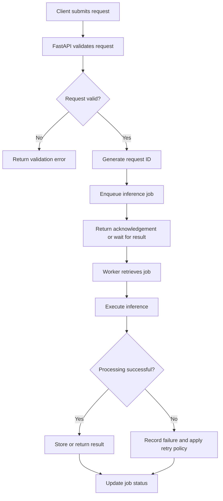
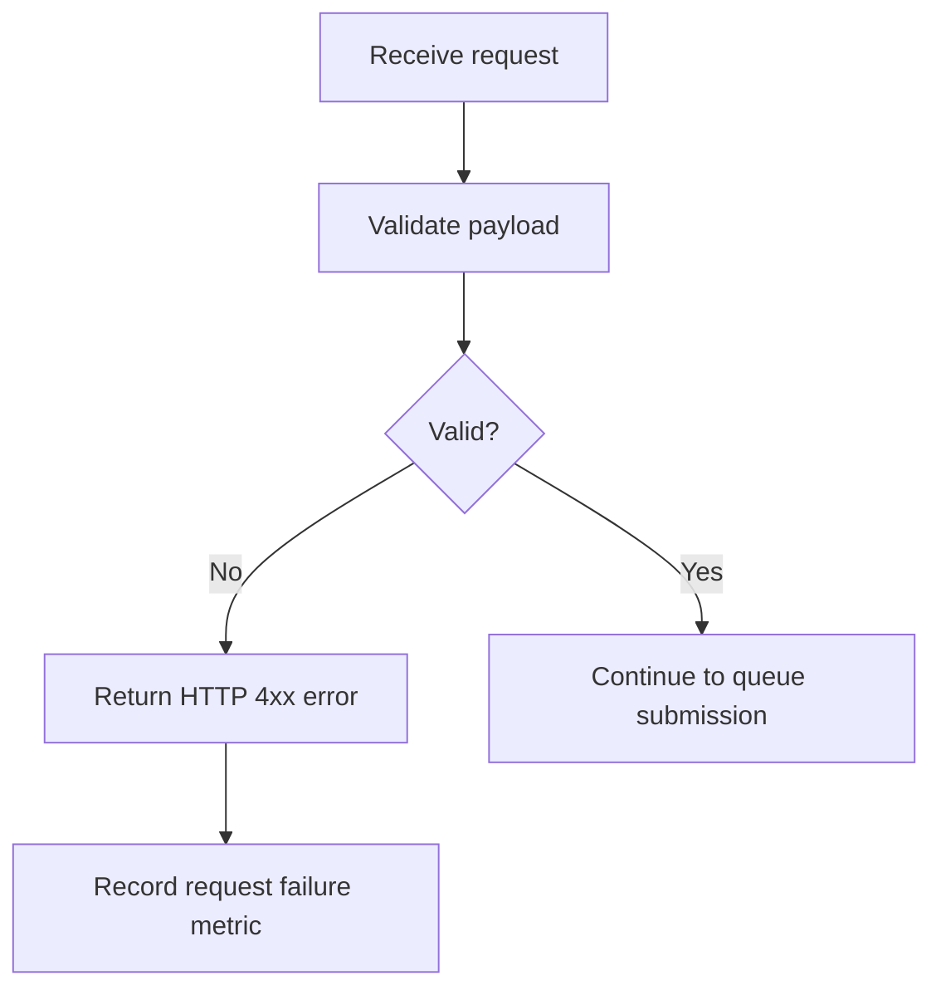
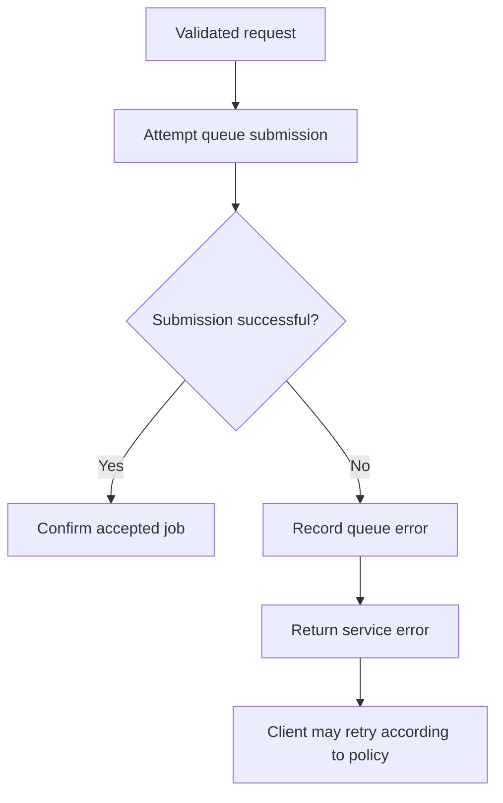
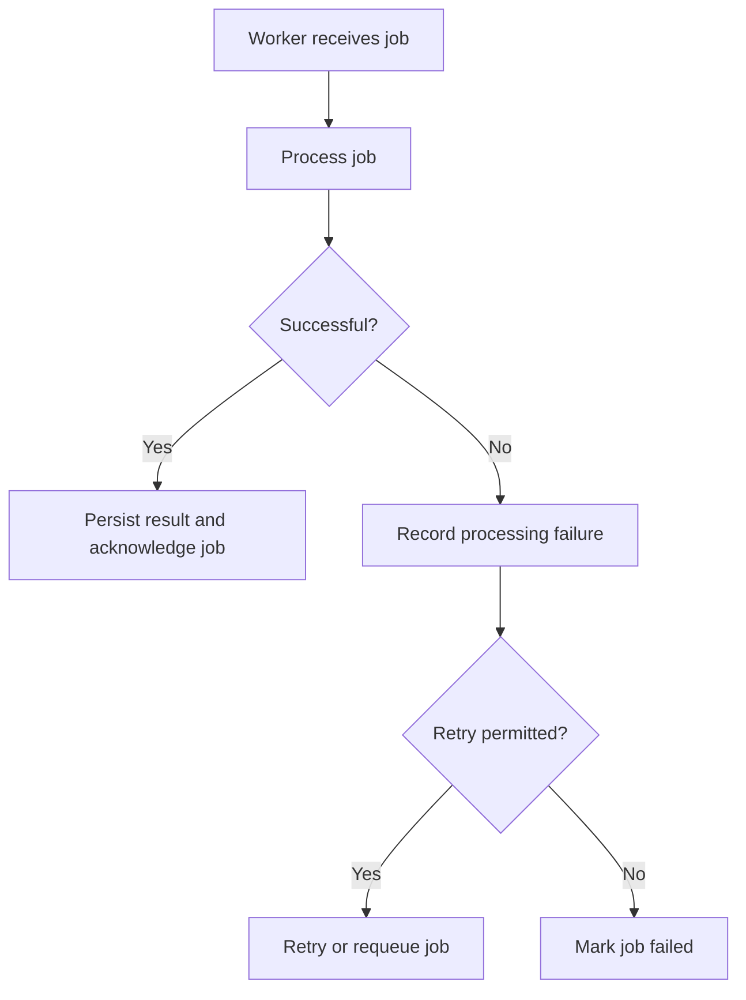
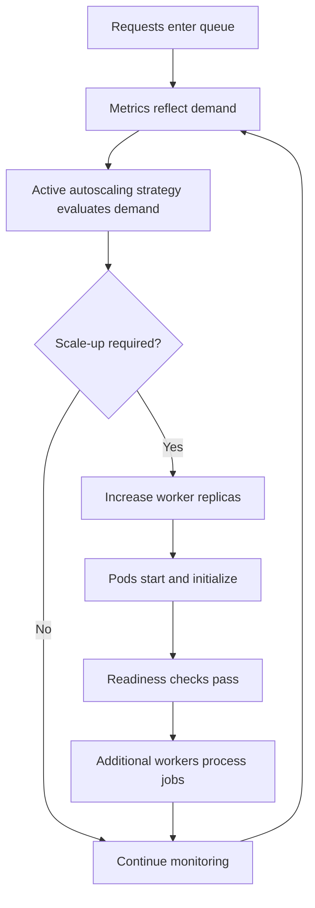
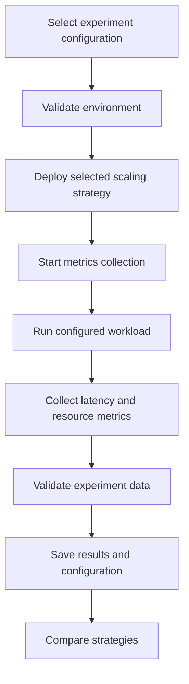
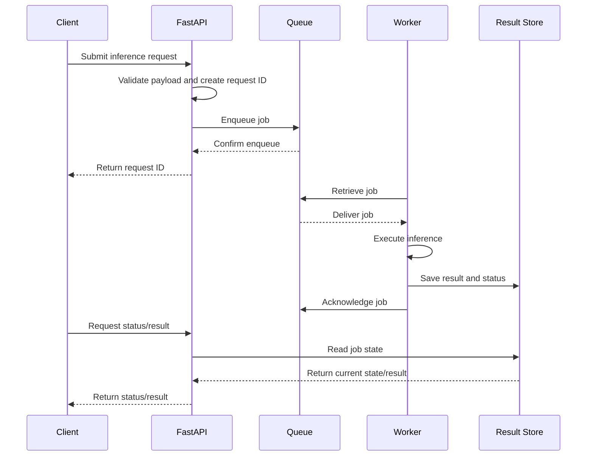

# User Flow and Request Lifecycle

## 1. Actors

| Actor | Responsibility |
|---|---|
| Client | Submits inference requests and retrieves results. |
| Load Generator | Produces controlled workloads for experiments. |
| FastAPI Service | Validates requests and submits jobs to the queue. |
| Message Queue | Holds pending jobs until workers process them. |
| Inference Worker | Executes inference and reports job outcomes. |
| Autoscaler | Adjusts worker replicas based on the active scaling policy. |
| Prometheus | Collects system and workload metrics. |
| Experimenter | Configures workloads, runs experiments, and analyzes results. |

## 2. Primary Request Flow

The API response behavior depends on the selected processing mode:

- **Asynchronous mode:** Return a request ID after the job is accepted. The client checks a status endpoint or retrieves the result later.
- **Synchronous mode:** Wait for the inference result and return it in the HTTP response, subject to a configured timeout.

The implementation must select and document one primary mode before end-to-end testing.

## 3. Asynchronous Request Flow

This is the proposed flow if the system uses asynchronous job processing.

1. The client sends a request to the inference submission endpoint.
2. FastAPI validates the payload.
3. The service generates a unique request ID.
4. The job is added to the queue.
5. The API returns the request ID and an accepted status.
6. The client requests the job status using the request ID.
7. A worker processes the job and records its result.
8. The status endpoint returns the current state or completed result.

### Job states

| State | Meaning |
|---|---|
| `accepted` | The API accepted the request. |
| `queued` | The job is waiting for a worker. |
| `processing` | A worker is executing the job. |
| `completed` | The job finished successfully. |
| `failed` | Processing failed and no further retry will be attempted. |
| `timeout` | The configured job deadline was exceeded. |

These are proposed application-level states. The actual queue implementation may use additional internal states.

## 4. Invalid Request Flow

Expected behavior:

- Reject missing or malformed fields.
- Return an appropriate HTTP 4xx response for invalid input.
- Do not enqueue invalid jobs.
- Record failure metrics without logging sensitive request content.

## 5. Queue Failure Flow

Expected behavior:

- Do not report a job as accepted if queue submission failed.
- Return a suitable service error, such as HTTP 503, when the queue is unavailable.
- Log the failure and update monitoring metrics.
- Define client retry behavior and use idempotency protection where necessary to avoid duplicate jobs.

## 6. Worker Failure and Retry Flow

The implementation must define:

- Maximum retry attempts.
- Retry delay and backoff policy.
- Job acknowledgement behavior.
- Handling of workers that terminate during processing.
- Protection against duplicate results.
- A policy for jobs that repeatedly fail.

A retry must not create an unlimited processing loop.

## 7. Autoscaling Flow

Expected behavior:

1. Requests accumulate when incoming demand exceeds available processing capacity.
2. The active scaling strategy evaluates the configured metrics.
3. The strategy requests a replica-count change when its conditions are satisfied.
4. Kubernetes starts or terminates worker pods as required.
5. New pods become available only after initialization and readiness checks.
6. Workers process pending jobs.
7. The system continues monitoring demand and capacity.

The time required to start a worker is part of the evaluation. A scaling decision does not mean that additional capacity is immediately available.

Only one scaling mechanism should control the worker replica count in a given experiment.

## 8. Experiment Execution Flow

The experimenter should:

1. Select the scaling strategy and workload profile.
2. Record the environment, model type, queue configuration, and replica limits.
3. Confirm that metrics collection is working.
4. Run the workload for the configured duration.
5. Save request-level or aggregate measurements.
6. Check for missing data, errors, and incomplete runs.
7. Repeat experiments where needed.
8. Compare the results using the methodology in `docs/EXPERIMENT_PLAN.md`.

## 9. Main API Interaction Sequence

The following is an illustrative asynchronous interaction. Endpoint names are proposed and may change during implementation.

The result store may be implemented using a database, Redis, or another suitable mechanism. It is a separate design decision from the queue and must be finalized before the asynchronous workflow is implemented.

## 10. Flow Acceptance Criteria

- [ ] Valid requests receive unique request IDs.
- [ ] Invalid requests are rejected before queue submission.
- [ ] Queue submission failures are reported correctly.
- [ ] Accepted jobs can be tracked through their lifecycle.
- [ ] Workers update job status and handle processing failures.
- [ ] Retry and timeout behavior is defined and tested.
- [ ] Worker readiness is verified before the pod is considered available.
- [ ] Scaling behavior can be observed through metrics.
- [ ] Experiment configurations and results can be saved.
- [ ] End-to-end tests cover successful requests and important failure cases.
